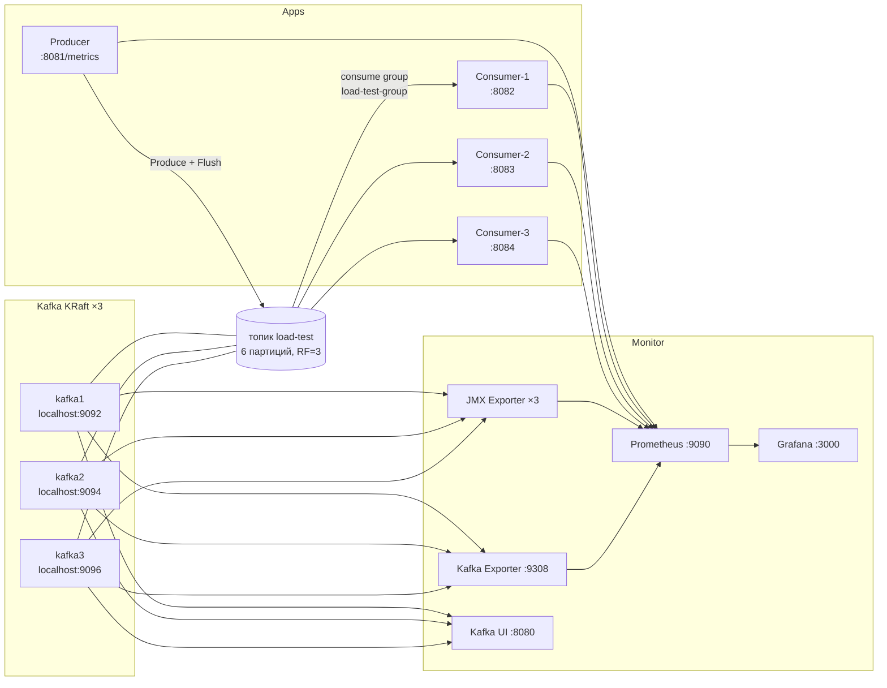
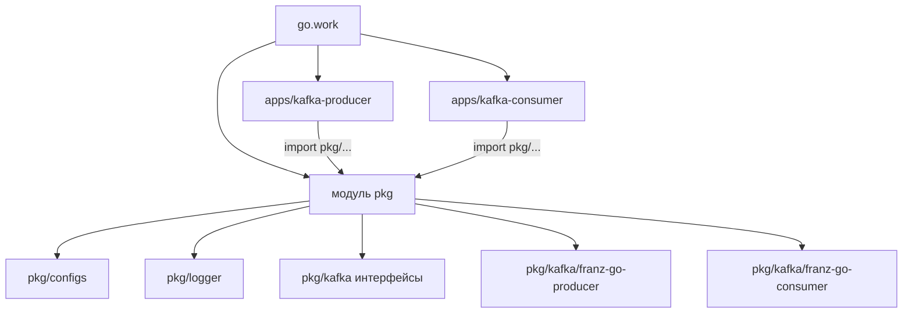
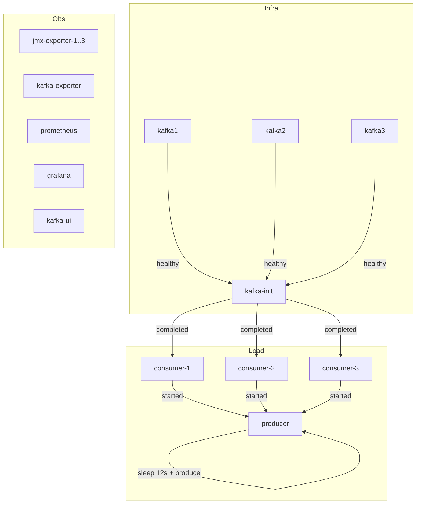
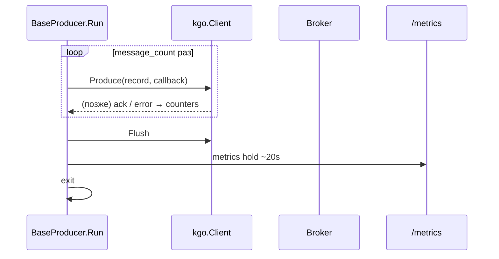

# Info: архитектура стенда Kafka_stend_go

Документ для джуна. Здесь — **что это за проект**, **как устроены папки**,
**какие настройки и зачем**, **как крутится Docker Compose**.

Практический запуск: [`workflow.md`](workflow.md).  
Команды и эндпоинты: [`start.md`](start.md).  
Обзор и env-таблица: [`README.md`](README.md).

---

## 1. Что это такое (одной фразой)

Локальный **нагрузочный стенд** Apache Kafka 4.x (KRaft) + клиенты на
**franz-go** (Go):

- продюсер шлёт ~100 000 сообщений в топик `load-test`;
- три консьюмера в **одной** группе `load-test-group` читают;
- метрики смотрим в Prometheus / Grafana.

Это **не production**: без TLS/SASL/ACL. Часть настроек специально
ускоряет прогон и **не** является «правильной» прод-семантикой
(например, `acks=leader`, идемпотентность выключена).

---

## 2. Большая картина



**Поток данных:** Producer → топик → 3 consumers (делят 6 партиций).  
**Поток метрик:** приложения + JMX + Kafka Exporter → Prometheus → Grafana.

---

## 3. Как организован репозиторий (Go workspace)

В корне `go.work` объединяет **три модуля**:

```text
Kafka_stend_go/
├── go.work                 # workspace: pkg + 2 apps
├── Makefile                # up / down / producer / logs ...
├── pkg/                    # общая библиотека (модуль pkg)
├── apps/
│   ├── kafka-producer/     # приложение-продюсер
│   └── kafka-consumer/     # приложение-консьюмер (один бинарь, 3 реплики)
└── deployments/            # Docker Compose, Prometheus, Grafana, JMX
```



**Идея:** бизнес-запуск и DI живут в `apps/*`, а «как говорить с Kafka»
и «как читать YAML/env» — в `pkg`. Так проще тестировать клиент без
Docker и переиспользовать код в двух приложениях.

---

## 4. Папка `pkg` — что внутри и зачем

### 4.1. `pkg/configs`

Единый конфиг Kafka для **обоих** приложений:

| Файл                     | Роль                                                                                                                               |
| ------------------------ | ---------------------------------------------------------------------------------------------------------------------------------- |
| `kafka_client_config.go` | Структура `KafkaClientConfig` + Producer/Consumer секции, Validate, env overrides, `ToKgoProducerOptions` / `ToKgoConsumerOptions` |
| `config_loader_yml.go`   | Загрузка YAML с дефолтами                                                                                                          |
| `duration.go`            | Тип `Duration` для полей вроде `50ms`, `30s` в YAML                                                                                |

**Порядок загрузки (важно):**

1. Дефолты из `DefaultKafkaClientConfig()`
2. YAML (`producer.yml` / `consumer.yml`)
3. Env-переменные (перебивают YAML) — удобно для экспериментов
4. `Validate()` — жёсткие ошибки или безопасные дефолты

Ошибки парсинга env **не глотаются** (fail-fast): опечатка вроде
`PRODUCER_LINGER=100msx` роняет старт, а не тихо применяет дефолт.

### 4.2. `pkg/kafka`

Тонкий слой контрактов:

- `interfaces.go` — `Producer`, `Consumer`, `MessageHandler`
- `models.go` — `Message`
- `franz-go-producer/` — реализация продюсера на franz-go
- `franz-go-consumer/` — реализация консьюмера на franz-go

Приложения зависят от **интерфейсов**, а не от деталей franz-go.
Внутри consumer есть узкий `KafkaClient` (Poll / CommitRecords / Close) —
его мокают в юнит-тестах без брокера.

### 4.3. `pkg/logger`

Общий slog-логгер + YAML-конфиг уровня/формата.

---

## 5. Как устроены приложения (`apps/`)

### Продюсер `apps/kafka-producer`

```text
cmd/                  # main, DI, Run, graceful shutdown, metrics server
internal/config/      # LoadConfig → pkg/configs
internal/deps/        # Container: logger, kgo.Client, producer, /metrics
configs-yml/
  producer.yml
  logger.yml
```

Жизненный цикл:

1. Загрузить конфиг
2. Поднять DI (клиент + BaseProducer + HTTP `/metrics`)
3. `Run`: async `Produce` → `Flush` → **metrics hold ~20s** → выход
4. Close клиента через `Producer.Close`

Контейнер в Compose: `restart: no` — это **job**, не демон.

### Консьюмер `apps/kafka-consumer`

```text
cmd/                  # main, Start loop, metrics, graceful shutdown
internal/config/
internal/deps/
internal/consumer/    # CountHandler — считает + Prometheus metrics
configs-yml/
  consumer.yml
  logger.yml
```

Один и тот же бинарь запускается **три раза** (consumer-1/2/3) с разными
портами метрик, но **одной** `CONSUMER_GROUP_ID=load-test-group`.

Handler (`CountHandler`) почти пустой: только считает. Метрики
`consumer_messages_*` растут **после успешного commit** (через
`OnBatchProcessed`), а не в момент вызова handler.

---

## 6. Параметры: что выставлено и почему

### 6.1. Брокеры (Compose)

| Параметр                           | Значение                  | Почему                                         |
| ---------------------------------- | ------------------------- | ---------------------------------------------- |
| Образ                              | `apache/kafka:4.0.0`      | Kafka 4.x, KRaft без ZooKeeper                 |
| Нод                                | 3 (broker+controller)     | RF=3 и кворум контроллеров                     |
| Heap                               | `-Xmx512m -Xms512m`       | Компактный стенд, меньше пауз GC               |
| `NUM_IO_THREADS`                   | 4                         | Под ~2 выделенных ядра на брокер               |
| `NUM_NETWORK_THREADS`              | 2                         | То же                                          |
| `NUM_REPLICA_FETCHERS`             | 2                         | Репликация RF=3 без лишних потоков             |
| `AUTO_CREATE_TOPICS`               | false                     | Топик только через `kafka-init` — предсказуемо |
| Offsets RF / txn RF                | 3                         | Согласовано с 3 брокерами                      |
| `GROUP_INITIAL_REBALANCE_DELAY_MS` | 0                         | Быстрее стабилизация группы на стенде          |
| CPU limit                          | `2.0`, `cpu_shares: 4096` | Брокеры в приоритете при конкуренции           |
| Порты с хоста                      | 9092 / 9094 / 9096        | Клиенты с хоста; внутри Docker — `*:19092`     |

Топик (`kafka-init`):

| Параметр   | Значение    | Почему                                         |
| ---------- | ----------- | ---------------------------------------------- |
| Имя        | `load-test` | Единое имя во всех конфигах                    |
| Partitions | 6           | Удобно делить на 3 консьюмера (по ~2 партиции) |
| RF         | 3           | Полная репликация на 3 брокера                 |

### 6.2. Продюсер

Из `apps/kafka-producer/configs-yml/producer.yml` + дефолты `pkg/configs`:

| Параметр               | Значение  | Почему                                                                  |
| ---------------------- | --------- | ----------------------------------------------------------------------- |
| `message_count`        | 100_000   | Короткий сравнимый прогон (не 10M)                                      |
| `linger`               | 50ms      | Батчинг: выше throughput, чуть выше latency                             |
| `batch_max_bytes`      | 1 MiB     | Крупные батчи → меньше round-trips                                      |
| `compression`          | snappy    | Баланс CPU ↔ размер на сети                                             |
| `required_acks`        | leader    | Быстрее, чем `all` (стенд, не прод)                                     |
| `disable_idempotency`  | true      | Снимает лимиты идемпотентного продюсера → выше скорость; возможны дубли |
| `max_buffered_records` | 1_000_000 | Большой клиентский буфер под burst                                      |
| `metrics_addr`         | `:8081`   | Prometheus scrape                                                       |
| `metrics_hold`         | 20s       | После Flush процесс живёт, чтобы scrape 5s успел снять 2–3 сэмпла       |

Поведение кода:

- async `Produce` + колбэк ack/error;
- в конце `Flush`;
- затем hold `/metrics`;
- в Compose перед стартом `sleep 12` — группа consumers успевает join.

### 6.3. Консьюмер

Из `consumer.yml` + `ConsumerOptions`:

| Параметр            | Значение                  | Почему                                                                    |
| ------------------- | ------------------------- | ------------------------------------------------------------------------- |
| `group_id`          | `load-test-group`         | Одна группа → нормальное деление партиций                                 |
| `start_offset`      | `earliest`                | Новая группа не теряет сообщения, если produce начался чуть раньше Stable |
| Auto-commit         | **всегда выключен**       | Иначе можно закоммитить необработанное                                    |
| Commit              | manual, contiguous prefix | Без «дыр» в offset (иначе silent loss)                                    |
| `max_batch_size`    | 1000                      | Чанки внутри фетча; фетч целиком не отбрасывается                         |
| `session_timeout`   | 30s                       | Стандарт group-протокола                                                  |
| `rebalance_timeout` | 60s                       | Запас на rebalance трёх членов                                            |
| `metrics_addr`      | `:8082` внутри            | На хосте 8082/8083/8084 у трёх реплик                                     |
| `ShutdownTimeout`   | 30s                       | Согласован с graceful shutdown приложения                                 |

**Критичный инвариант at-least-once:**

```text
ошибка handler на offset N партиции P
  → не коммитим offsets > N в этой партиции (весь остаток фетча тоже)
  → при рестарте сообщения придут снова
```

Метрики processed/batches = **после успешного commit**, не «просто вызвали handler».

---

## 7. Как организован Docker Compose

Файл: `deployments/docker-compose.yml`  
Env: `deployments/.env.example` (Makefile всегда передаёт `--env-file`).

Нужен **`docker compose` v2**: секция `deploy.resources.limits.cpus`
иначе игнорируется.

### 7.1. Сервисы по слоям



| Слой       | Сервисы                                              | Заметки                            |
| ---------- | ---------------------------------------------------- | ---------------------------------- |
| Кластер    | kafka1/2/3                                           | healthcheck на INTERNAL `:19092`   |
| Init       | kafka-init                                           | создаёт топик, `restart: no`       |
| Нагрузка   | consumer×3, producer                                 | producer зависит от init+consumers |
| Мониторинг | jmx×3, kafka-exporter, prometheus, grafana, kafka-ui |                                    |

Сеть: `kafka-stend` (bridge).  
Тома: `kafka1-data`, `kafka2-data`, `kafka3-data` (данные переживают `down` без `-v`).

### 7.2. Ресурсы (лимиты)

Идея: **брокеры важнее** нагрузки и UI.

| Сервис              | cpus    | cpu_shares |
| ------------------- | ------- | ---------- |
| kafka×3             | 2.0     | 4096       |
| producer / consumer | 1.0     | 1024       |
| prometheus          | 1.0     | 512        |
| kafka-exporter      | 0.5     | 512        |
| jmx / grafana / ui  | 0.3–0.5 | 256        |
| kafka-init          | 0.5     | 128        |

### 7.3. Порты с хоста (шпаргалка)

| Порт               | Что                       |
| ------------------ | ------------------------- |
| 9092 / 9094 / 9096 | Брокеры (EXTERNAL)        |
| 8080               | Kafka UI                  |
| 3000               | Grafana (`admin`/`admin`) |
| 9090               | Prometheus                |
| 8081               | Producer `/metrics`       |
| 8082–8084          | Consumer `/metrics`       |
| 9308               | Kafka Exporter            |
| 7071–7073          | JMX Exporter              |

### 7.4. Observability внутри Compose

- Prometheus scrape **каждые 5s**: jmx, kafka-exporter, producer, consumer, self
- Grafana provisioning: datasource `prometheus` + дашборд `Kafka load-test`
- Дашборд заточен под эксперименты: throughput, acks, CPU/RAM, lag по партициям, end-to-end

---

## 8. Конфиги: как с ними жить джуну

### Файлы

| Приложение   | YAML                                           |
| ------------ | ---------------------------------------------- |
| Producer     | `apps/kafka-producer/configs-yml/producer.yml` |
| Consumer     | `apps/kafka-consumer/configs-yml/consumer.yml` |
| Оба          | `logger.yml` рядом                             |
| Compose/Make | `deployments/.env.example`                     |

### Эксперимент (менять **один** параметр)

Через env (предпочтительно):

```powershell
$env:PRODUCER_LINGER="100ms"
$env:MESSAGE_COUNT="100000"
make producer
```

Через `.env.example` — тоже можно, но тогда не забудь, что Makefile
всегда подхватывает этот файл.

Типичные рычаги: `PRODUCER_LINGER`, `PRODUCER_BATCH_MAX_BYTES`,
`PRODUCER_COMPRESSION`, `PRODUCER_REQUIRED_ACKS`,
`PRODUCER_DISABLE_IDEMPOTENCY`, `MESSAGE_COUNT`, `PRODUCER_METRICS_HOLD`.

Таблица прогонов: [`docs/experiments.md`](docs/experiments.md).

---

## 9. Как связаны код и Kafka (упрощённо)

### Продюсер



### Консьюмер

```mermaid
sequenceDiagram
  participant Loop as BaseConsumer.Start
  participant Kgo as kgo.Client
  participant H as CountHandler
  participant Br as Broker

  loop пока не shutdown
    Loop->>Kgo: PollFetches
    Loop->>Loop: режем фетч чанками max_batch_size
    loop записи чанка
      Loop->>H: HandleMessage
      alt ошибка
        Loop->>Loop: block partition до конца фетча
      else ok
        Loop->>Loop: в список на commit
      end
    end
    Loop->>Kgo: CommitRecords(только contiguous prefix)
    Kgo->>Br: commit offsets
    Loop->>H: OnBatchProcessed → Prometheus
  end
```

---

## 10. Makefile — быстрые команды

| Команда                                   | Смысл                                   |
| ----------------------------------------- | --------------------------------------- |
| `make up`                                 | Всё: инфра + consumers + producer       |
| `make infra`                              | Только брокеры + мониторинг + UI        |
| `make load`                               | Consumers + один producer (нужен infra) |
| `make producer`                           | Ещё один прогон продюсера               |
| `make status` / `topic-describe` / `logs` | Проверки                                |
| `make down`                               | Стоп (тома остаются)                    |
| `make producer-local` / `consumerN-local` | Запуск Go с хоста                       |

Подробный сценарий «нажми сюда»: [`workflow.md`](workflow.md).

---

## 11. Что запомнить джуну (чек-лист)

1. Это **стенд для экспериментов**, не прод-кластер.
2. Общая логика Kafka — в **`pkg`**, запуск — в **`apps`**, инфра — в **`deployments`**.
3. Конфиг: **YAML → env → Validate**; для опытов удобнее env.
4. Consumer: **одна группа**, **manual commit без дыр**, метрики **после commit**.
5. Producer: после отправки **держится /metrics ~20s**.
6. Compose v2 + CPU limits; брокеры с большим `cpu_shares`.
7. Смотри графики в Grafana (`Kafka load-test`), не только логи.

Если что-то непонятно в коде — начни с `pkg/configs/kafka_client_config.go`
и YAML в `configs-yml/`: там почти все «почему так выставлено».
